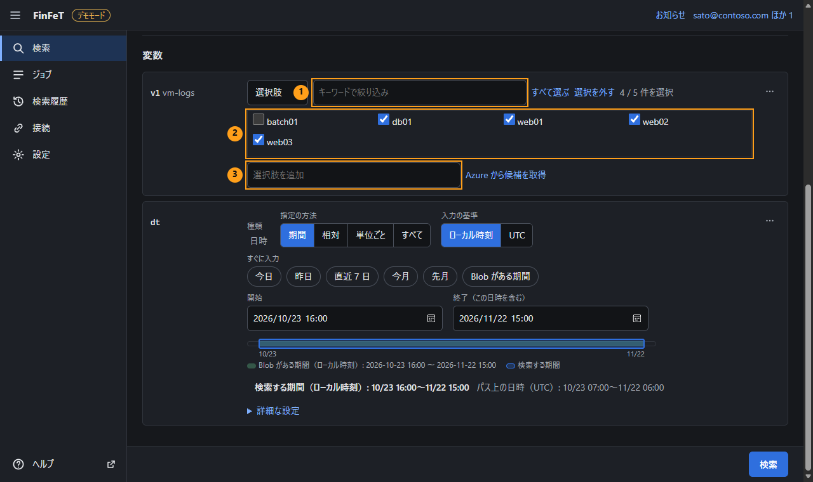

# FinFeT（Azure Blob Storage用検索・取得ツール）

> 本ツールは、Azure Blob Storage を利用するための非公式のツールです。Microsoft Corporation およびその関連会社が開発・提供するものではなく、Microsoft による提携、承認、後援を受けていません。Microsoft、Azure は、Microsoft グループの企業の商標です。
>
> This is an unofficial tool for Azure Blob Storage. It is not developed, provided, endorsed, or sponsored by Microsoft Corporation or its affiliates. Microsoft and Azure are trademarks of the Microsoft group of companies.

FinFeT は、Azure のストレージアカウントに保存されたログやファイルから、条件に一致するものだけを検索し、PC にまとめてダウンロードするための Windows 用のツールです。たとえば「11 月 1 日から 7 日までの、web01 と web02 のログ」のように、ファイル名の規則と期間を指定して対象を絞り込めます。

Archive 層の Blob は、そのままでは読み取れません。本ツールは、オンライン層に戻す操作（リハイドレート）を要求し、数時間かかる完了を待ってから、自動的にダウンロードします。



## 主な用途

- 診断設定で出力したログが `y=2026/m=11/d=21/h=09/...` のような日付の階層に大量に保存されており、Azure Portal や Azure Storage Explorer で目的のファイルを探すのに手間がかかる場合
- 監査や障害の調査のために、アーカイブ済みのログのうち、特定の期間の分だけを取り出す場合
- リハイドレートに時間がかかるため、要求だけを先に行い、ダウンロードは後日に行う場合
- ネットワークの帯域を占有しないよう、ダウンロードの速度を制限する場合

## 主な機能

- **パスパターンによる検索**: ファイル名の規則を、日時・選択肢・文字列などの変数を含むパターンで指定します。パターンが不明な場合は、コンテナーの Blob 名からパターンの候補を自動生成できます。診断設定のログなどのよく使われる形式は、一覧から選択できます。
- **期間の指定**: 日付・時刻の入力欄、「今日」「直近 7 日」などの指定、Blob が存在する期間の表示により、検索する期間を指定します。
- **ジョブとキュー**: 選択した Blob の取得を「ジョブ」として登録し、順番に実行します。リハイドレートの要求、完了の確認、ダウンロード、MD5 の照合までを一つのジョブで行います。本ツールを終了しても、次回の起動時に続きから再開します。
- **圧縮ファイルの展開**（任意）: ダウンロードした zip・tar・gz・bz2・xz のファイルを、同じフォルダーに展開します。
- **自動終了**: 本ツールの画面（ブラウザのタブ）をすべて閉じると、一定時間後に本ツールを終了します。実行中のジョブがある場合は、完了するまで終了しません。
- **画面幅に応じたレイアウト**: ブラウザの幅に応じて、ナビゲーションと表の配置を切り替えます。幅が狭い場合も、横方向にスクロールせずに操作できます。テーマ（ダーク・ライト）と文字の大きさは、設定で変更できます。

## 利用手順

1. **接続先を追加する**: Microsoft Entra ID のアカウントでサインインし、ストレージアカウントとコンテナーを選択します。アクセスキー、SAS、接続文字列でも追加できます。
2. **検索する**: パスパターンと期間を指定して、検索を実行します。
3. **ジョブを作成する**: 検索結果から必要な Blob を選択し、保存先のフォルダーを指定してジョブを作成します。
4. **完了を待つ**: ジョブはキューの順に実行されます。進捗と結果は、ジョブページで確認できます。

操作の詳細は、同梱の使い方（`docs\usage.html`）を参照してください。本ツールの画面の [ヘルプ] からも開けます。Azure に接続せずに架空のデータで操作を試す場合は、`finfet-abs.bat --demo` で起動します（デモモード）。

## 安全性について

- 本ツールが Azure に対して行う操作は、Blob の読み取りと、アクセス層の変更（リハイドレート）に限られます。Blob のアップロード・削除・上書きは行いません。
- 画面は、PC 内で動作するローカルの Web サーバー（`127.0.0.1`）を既定のブラウザで表示します。外部のネットワークには公開しません。
- 保存したアクセスキーや SAS は、Windows のデータ保護 API（DPAPI）で暗号化します。ほかの Windows ユーザーは読み取れません。また、ログには秘密情報を出力しません。
- リハイドレートには Azure の料金がかかり、要求した後に取り消すことはできません。ジョブの作成時に、対象の件数・サイズと注意事項を表示します。

## 動作環境

- Windows 11（x64）
- Python などのインストールは不要です。配布する ZIP ファイルに、Python と必要なパッケージが含まれています。

## 導入

1. [Releases](https://github.com/nahi-da/finfet-abs/releases) から `finfet-abs-<版>-win-x64.zip` と `SHA256SUMS.txt` をダウンロードします。
2. ダウンロードしたファイルが破損していないことを確認します。`certutil -hashfile finfet-abs-<版>-win-x64.zip SHA256` で表示される値が、`SHA256SUMS.txt` に記載された値と一致することを確認してください。
   GitHub CLI を利用できる場合は、このリポジトリの GitHub Actions で作成されたファイルであることも確認できます: `gh attestation verify finfet-abs-<版>-win-x64.zip --repo nahi-da/finfet-abs`
3. ZIP ファイルを右クリックして [プロパティ] を開き、[許可する] をオンにして [OK] をクリックします。その後、任意のフォルダーに展開します（この操作を行わないと、起動時に Windows の警告が表示されます）。
4. 展開したフォルダーの `finfet-abs.bat` をダブルクリックします。既定のブラウザに本ツールの画面が表示されます。

インターネットに接続できない PC で使用する場合は、接続できる PC でダウンロードとハッシュの確認を行い、ZIP ファイルを移してから展開してください。詳細は、同梱の `docs\setup.html` を参照してください。

### 新しい版への更新

新しい版の ZIP ファイルを**新しいフォルダー**に展開し、古い版の本ツールを終了してから、新しいフォルダーの `finfet-abs.bat` を起動します。古い版のフォルダーには上書きしないでください。設定・検索履歴・ジョブは `%LOCALAPPDATA%\finfet-abs\` に保存されており、新しい版にそのまま引き継がれます。

### データの保存先（通常モードとポータブルモード）

| モード | 条件 | データの保存先 |
|---|---|---|
| 通常 | ポータブルモードの条件を満たさない場合 | `%LOCALAPPDATA%\finfet-abs\` |
| ポータブル | 本ツールのフォルダーに `data` フォルダーがある場合 | `<本ツールのフォルダー>\data\<Windows ユーザー名>\` |

- USB メモリなどに格納して持ち運ぶ場合は、起動する前に、本ツールのフォルダーに空の `data` フォルダーを作成します（ポータブルモード）。
- モードを切り替えても、データは自動的には移行されません。移行する場合は、本ツールを終了してから、`settings.json`・`finfet-abs.db`（および `finfet-abs.db-wal`・`finfet-abs.db-shm`）・`logs\` を、元の保存先から新しい保存先にコピーしてください。
- 保存した認証情報は、保存した Windows ユーザーだけが読み取れます。別のユーザーや別の PC で使用する場合は、接続先を追加し直してください。

## 開発

- 必要な環境: Windows 11（x64）、Python 3.14、Git
- 仮想環境の作成と、依存パッケージの導入

  ```
  python -m venv .venv
  .venv\Scripts\python.exe -m pip install --require-hashes -r setup\requirements.txt
  ```

- 起動（開発用）: `tools\dev-run.bat`（`--demo`、`--version` などの引数を指定できます）
- テスト: `tools\run_tests.bat`（リポジトリの検査と単体テストを実行します）
- 依存パッケージの版の固定: `python tools\lock_requirements.py`（`setup\requirements.in` から `setup\requirements.txt` を作成します）
- 実行環境の版の更新: `python tools\update_runtime.py`（Python の embed 版と pip の URL・SHA-256 を `setup\runtime.json` に書き込みます）
- 配布用の ZIP ファイルの作成: `python tools\build_release.py`（`dist\` に ZIP ファイルと `SHA256SUMS.txt` を作成します）。`v*` のタグを push すると、GitHub Actions が同じ手順で ZIP ファイルを作成し、Release の下書きを作成します。

## 貢献

- 不具合の報告と機能の要望は、Issue のテンプレートからお送りください。脆弱性については、公開の Issue ではなく、[SECURITY.md](SECURITY.md) に記載の方法で報告してください。
- プルリクエストを受け付けますが、マージするかどうかは保守者が判断します。お送りいただいた変更は、本リポジトリと同じ MIT License で提供されることに同意いただいたものとします。

## ライセンス

MIT License（[LICENSE](LICENSE)）。Copyright (c) 2026 Yu-gene。同梱するソフトウェアのライセンスは [THIRD_PARTY_NOTICES.md](THIRD_PARTY_NOTICES.md) を参照してください。
